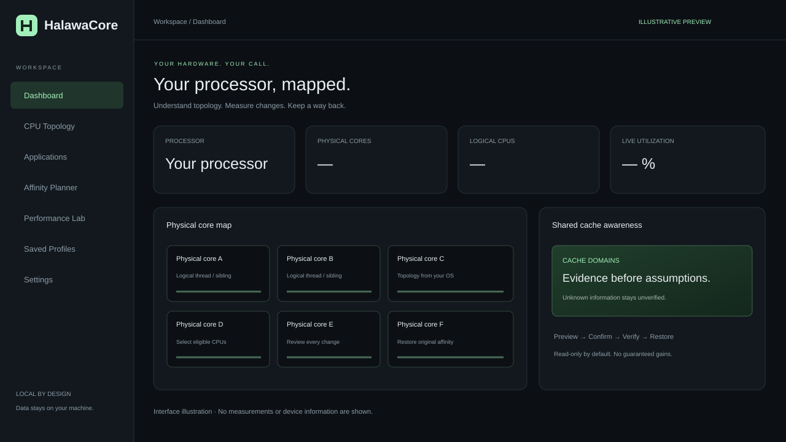

# HalawaCore

**افهم معالجك. قِس تجربتك. احتفظ بخيار العودة.**

برنامج محلي مفتوح المصدر لعرض الأنوية الفعلية وخيوط SMT والكاش المشترك، فحص العمليات، وتجربة توزيعها على المعالج مع التأكيد والاستعادة.

- [الموقع التعريفي](https://MOOODEGRX-nah.github.io/HalawaCore/)
- [صفحة البرنامج والتنزيل](https://MOOODEGRX-nah.github.io/HalawaCore/app.html)
- [الملفات التنفيذية وملاحظات الإصدار](https://github.com/MOOODEGRX-nah/HalawaCore/releases)

## للمستخدم: بدون أوامر

1. افتح صفحة البرنامج واختر ملف نظامك.
2. فك الضغط وافتح **HalawaCore.exe** على Windows، أو **HalawaCore** على Linux.
3. ستفتح الواجهة تلقائيًا في متصفحك. يبدأ البرنامج بوضع القراءة فقط.
4. أي تجربة أنوية تحتاج تفعيلًا ومراجعة وتأكيدًا منفصلًا.
5. استعد كل التجارب وأوقف التسجيل، ثم اضغط **Quit HalawaCore**. إغلاق التبويب وحده لا يوقف البرنامج المحلي.

لا يحتاج الإصدار التنفيذي إلى تثبيت Python. التحليل محلي؛ لا تُرسل بيانات العمليات إلى خدمة سحابية. الموقع يوفّر المعلومات والتنزيل، ولا يتحكم في جهاز الزائر.



## Features

- Physical core, SMT, package, NUMA and shared L3 topology from operating-system evidence.
- Conservative AMD X3D cache-domain identification. Cache masks remain separate from die/CCD identifiers; missing evidence remains unverified.
- Process/thread inspection, observed relationships, task identity validation and private command summaries.
- Default scheduler, cache, frequency, background and NUMA experiments where supported, without guaranteed performance claims.
- Confirmed per-task affinity preview/apply/read-back/restore. Saved profiles never apply automatically.
- Real utilization, process memory and thread measurements. No invented FPS, latency, temperature or power data.
- Local interface bundled into desktop executables, with no user-side Python setup.
- Arabic product/download website in `site/`, with a separate program page and verified GitHub release links.

## Platform status

| Platform | Support and limits |
| --- | --- |
| Linux x64 | Kernel topology, CPPC/X3D when exposed, processes, recordings and reversible task affinity. Live Linux runtime validation. |
| Windows 10 / 11 x64 | Initial native Win32 adapter: topology/cache masks, FILETIME identities, SID ownership and reversible per-thread group affinity on single-group systems. Native CI reports accompany builds. |
| Windows multiple groups | Topology analysis only. Mutation is disabled until complete cross-group state restoration is implemented. |
| Explicit Windows CPU Sets | Target stays read-only. Missing CPU Set query interfaces also produce read-only behavior. |
| X3D hardware | Synthetic fixture coverage; physical X3D performance/hardware validation has not been performed. |

On Windows, the default task is the **oldest surviving thread**, not an assumption that PID equals TID or that the original primary thread survives. Explicit TID selection is available. Internal CPU IDs are `group * 64 + processor index`; display labels use `G#:P#`. These are not Windows CPU Set IDs.

Linux CPPC and `amd_x3d_vcache` are not Windows interfaces. Windows scheduler preference is not guessed. Unknown cache/frequency domains remain unverified. Affinity can improve or reduce performance; preserve scheduler defaults when measurements do not support a change.

Linux GitHub Actions releases target glibc 2.35+. Locally built binaries may require the builder's newer glibc. Windows 10/11 desktop hardware is unavailable in this development environment; Wine and Windows Server CI checks are identified separately from physical desktop validation.

## Development and builds

Python 3.13 is used by the release workflow. Linux source development:

```sh
python3 -m venv .venv
.venv/bin/python -m pip install -r requirements-build.txt
.venv/bin/python -m pytest -q
.venv/bin/python desktop.py
```

On Windows, use `.venv\Scripts\python.exe`. Build on the target OS:

```sh
python build_desktop.py
```

`dist/desktop/HalawaCore` or `HalawaCore.exe` bundles Python, dependencies and the frontend. `desktop.py --self-test` starts the actual backend, queries topology, creates its own disposable child, and verifies affinity/restoration when supported. It never modifies pre-existing programs. Restricted environments report read-only behavior.

The Linux source launcher remains `run.sh`. See [Linux engineering details](docs/LINUX.md), [API](docs/API.md), [security](SECURITY.md), [validation](docs/VALIDATION.md) and [contributing](CONTRIBUTING.md). `requirements-lock.txt` records the original Linux development environment; Windows wheels differ. Runtime dependencies are pinned in `requirements.txt`; build tooling is in `requirements-build.txt`.

## Website and releases

Two GitHub Actions workflows are included:

- **Publish HalawaCore website** deploys only `site/` to GitHub Pages. `index.html` introduces the program; `app.html` provides downloads and startup instructions.
- **Build desktop releases** tests/builds on Windows and Ubuntu, packages executables plus verification reports, and publishes `v0.2.0` after both builds succeed.

The download page queries the latest public release and enables direct links only when matching assets exist. Otherwise it links to the release listing. It never offers a fake executable.

If the Pages token cannot enable hosting, the owner can select **Settings → Pages → Source: GitHub Actions**, then rerun the Pages workflow. This is a repository setting, not a code change.

No public hardware-control API, arbitrary shell/file API, automatic BIOS/driver changes, cloud processing, crash/SIGKILL recovery or permanent tracking of new child processes is implemented. Restore experiments before stopping the backend.

License: [MIT](LICENSE).
